# LPHRS evaluation results

_Generated 2026-10-05 21:55 UTC by `scripts/06_evaluate.py` (seed 42). Every number below is computed by code in this repository._

> **Wellness guidance only. Not medical advice.** This is a research prototype on synthetic data.

## Data

- **Clinical records:** Synthea, generated locally (generated; Java 21; `-p 1000 -s 42 --exporter.csv.export=true --exporter.fhir.export=false --exporter.years_of_history=15`). 1156 patients (1000 alive, 156 deceased). Reference date 2026-10-05.
- **Evaluation cohort:** 775 living adults (18+). Children and deceased patients stay in the timeline and in cohort-level statistics only.
- **Lifestyle, goals, preferences, injuries and feedback are synthetically generated.** No public dataset links these to clinical records. Sleep and steps are calibrated on the Sleep Health and Lifestyle dataset (374 people, ages 27-59); trends, noise, goals and preferences follow documented assumptions in `src/lphrs/synth_lifestyle.py`.
- **Risk model training data:** Kaggle Cardiovascular Disease dataset; **recipes:** 5,000 sampled Food.com meals (5-60 min, no alcohol, meal-type tags).

## Summary

| # | experiment | result |
|---|---|---|
| 1 | Safety | lists with a violation: 7.9% without filter → 0.0% with filter |
| 2 | Snapshot vs longitudinal | rising-but-normal metric targeted: 72.3% (U off) vs 72.5% (U on); 509 pairs |
| 3 | Early warning | U≥0.2: recall 7.3%, precision 23.2%, median lead 36 months (detected); latest ±5%: recall 46.3%, precision 25.8% |
| 4 | Decay | events > 5 y old: allergies keep 1.00 (plain 0.0000); chronic conditions 0.80 (plain 0.0015) |
| 5 | Set selection | conflicts/list 5.06 → 0.46; domains 2.03 → 3.37; within budget 47.2% → 100.0% |
| 6 | Weight learning (simulated) | acceptance, last 5 rounds: fixed 61.9% vs learned 63.8% (both 56.0% in rounds 1-5) |
| 7 | Risk model | test ROC-AUC LR 0.795 / XGBoost 0.806; Brier 0.185 / 0.178 |

## 1. Safety: pipeline with vs without SafetyFilter

Same patients, same scoring and set selection; only the filter is switched. A violation is a final top-5 item that any safety rule would remove for that patient.

| arm | lists | items | violating_items | item_violation_rate | lists_with_violation | list_violation_rate |
|---|---|---|---|---|---|---|
| with_filter | 775 | 3875 | 0 | 0.00% | 0 | 0.00% |
| without_filter | 775 | 3875 | 64 | 1.65% | 61 | 7.87% |

Rules that would have been broken without the filter (lists affected):

| rules | lists |
|---|---|
| joint_high_impact | 25 |
| allergy_match | 19 |
| cardiac_intensity_cap | 12 |
| hypertension_sodium_cap | 8 |
| knee_load | 3 |
| diabetes_sugar_cap | 1 |

With the filter the violation rate is 0.00% (target 0%).

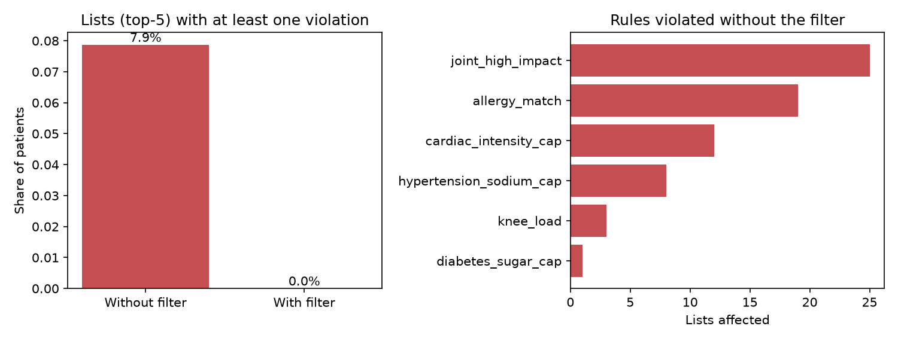

## 2. Snapshot vs longitudinal (urgency term off vs on)

Population: patient-metric pairs whose metric is still on the safe side of its threshold but trending toward it (urgency status *approaching*, direction *worsening*). Outcome: does the final list contain an item targeting that metric? The snapshot arm sets U = 0; everything else is identical.

509 pairs from 367 patients. Overall share targeted: **72.3% (U off) vs 72.5% (U on)**.

| metric | pairs | snapshot_U_off | longitudinal_U_on |
|---|---|---|---|
| bmi | 61 | 72.1% | 65.6% |
| diastolic_bp | 31 | 67.7% | 61.3% |
| glucose | 99 | 94.9% | 97.0% |
| hba1c | 8 | 75.0% | 75.0% |
| hdl | 26 | 23.1% | 19.2% |
| ldl | 39 | 87.2% | 92.3% |
| sleep_hours | 102 | 45.1% | 41.2% |
| steps | 75 | 80.0% | 84.0% |
| systolic_bp | 40 | 92.5% | 90.0% |
| total_cholesterol | 28 | 71.4% | 92.9% |

By the metric's urgency value:

| urgency_band | pairs | snapshot_U_off | longitudinal_U_on |
|---|---|---|---|
| < 0.05 | 208 | 76.9% | 76.4% |
| 0.05-0.2 | 200 | 72.0% | 71.5% |
| >= 0.2 | 101 | 63.4% | 66.3% |

Reading: switching U on changes the overall share targeted from 72.3% to 72.5%. For pairs with urgency ≥ 0.2 (101 pairs) it goes from 63.4% to 66.3%; for urgency < 0.05 (208 pairs) from 76.9% to 76.4%. Most rising metrics have low urgency, and many are targeted anyway through relevance, goals or broad interventions. U also lifts items for metrics already past their threshold (urgency 1), which compete for the same five slots, so the effect on an individual rising metric can be negative.

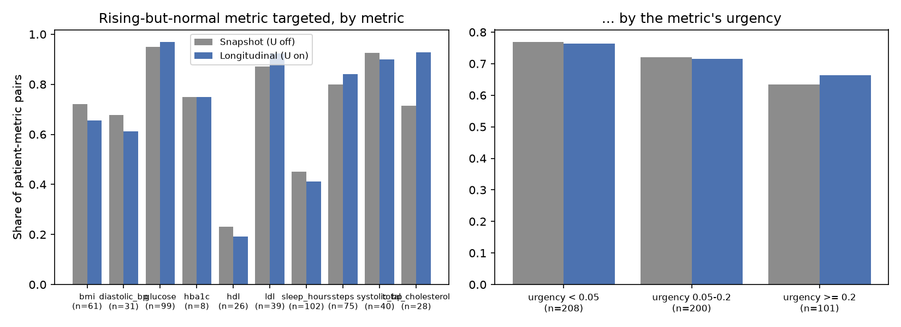

## 3. Early warning: urgency vs latest-value flag

Each patient's most recent 2 years are hidden (cut = 2024-10-05). Flags are computed only from readings up to the cut; outcomes are threshold crossings in the hidden part. Included: 3,559 patient-metric pairs (observation metrics with a threshold) that were not past the threshold at the cut and have readings on both sides; **259 crossed** in the hidden 2 years.

- *Urgency flag:* time-to-threshold urgency ≥ τ at the last pre-cut reading (τ = 0.1 / 0.2 / 0.3).
- *Latest-value flag:* the latest reading is within 2 / 5 / 10 % of the threshold on the bad side.
- *Lead time:* months from the start of the flag (the run of consecutive flagged readings still active at the cut) to the first hidden reading past the threshold. Readings are roughly yearly, so lead times are coarse.

| method | flagged | recall | precision | median_lead_months_detected | iqr_lead_months_detected | median_lead_months_all_crossers |
|---|---|---|---|---|---|---|
| urgency_0.1 | 184 | 11.6% | 16.3% | 36 | 22–57 | 0 |
| urgency_0.2 | 82 | 7.3% | 23.2% | 36 | 24–49 | 0 |
| urgency_0.3 | 36 | 4.2% | 30.6% | 24 | 24–37 | 0 |
| latest_value_0.02 | 128 | 18.1% | 36.7% | 13 | 12–36 | 0 |
| latest_value_0.05 | 465 | 46.3% | 25.8% | 36 | 24–132 | 0 |
| latest_value_0.1 | 1146 | 62.2% | 14.0% | 146 | 85–158 | 61 |

Crossings per metric:

| metric | pairs | crossed |
|---|---|---|
| bmi | 525 | 68 |
| diastolic_bp | 621 | 48 |
| glucose | 378 | 2 |
| hba1c | 323 | 5 |
| hdl | 323 | 40 |
| ldl | 359 | 29 |
| systolic_bp | 669 | 45 |
| total_cholesterol | 361 | 22 |

Reading: at a similar number of alarms (U≥0.2: 82; latest ±2%: 128), the latest-value flag has higher recall (18.1% vs 7.3%) and higher precision (36.7% vs 23.2%). For the crossings each method does detect, the median lead is 36 months (urgency) vs 13 months (latest value). Wider latest-value bands raise recall at the cost of many more alarms and lower precision; their long lead times mostly reflect values that sit near the threshold for years. On this synthetic data the trend-based urgency flag does not beat a simple near-threshold flag at detecting crossings within 2 years.

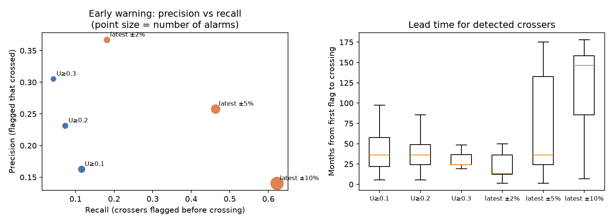

## 4. Decay: plain exponential vs persistence-floored adaptive

Weights of every condition / medication / allergy event older than 5 years in the cohort profiles (`w_plain` = exp(-λ·Δt); `w_recency` = max(floor, exp(-λ·Δt)), floor = severity × persistence).

| event_class | events | patients | floored_mean | floored_min | plain_mean | plain_max |
|---|---|---|---|---|---|---|
| acute_condition | 7946 | 773 | 0.005 | 0.000 | 0.0054 | 0.0310 |
| allergy | 826 | 155 | 1.000 | 1.000 | 0.0000 | 0.0021 |
| chronic_condition | 3236 | 625 | 0.800 | 0.800 | 0.0015 | 0.0310 |
| medication | 26394 | 770 | 0.005 | 0.000 | 0.0051 | 0.0311 |
| resolved_major | 722 | 399 | 0.300 | 0.300 | 0.0031 | 0.0311 |
| social_finding | 12830 | 775 | 0.005 | 0.000 | 0.0047 | 0.0311 |

Allergies and chronic conditions older than 5 years keep weights of 1.00 and 0.80 with the floor, versus 0.0000 and 0.0015 with plain decay; acute conditions and old medications fade identically under both schemes.

Metric decay rates from cohort volatility (half-life = ln 2 / λ):

| index | rel_change_sd | volatility | lambda | half_life_days |
|---|---|---|---|---|
| body_weight | 0.0200 | 0.17 | 0.00047 | 1459 |
| bmi | 0.0206 | 0.17 | 0.00047 | 1459 |
| hba1c | 0.0570 | 0.48 | 0.00091 | 762 |
| diastolic_bp | 0.0662 | 0.56 | 0.00106 | 655 |
| systolic_bp | 0.0681 | 0.57 | 0.00109 | 637 |
| sleep_hours | 0.0730 | 0.61 | 0.00117 | 595 |
| glucose | 0.1650 | 1.39 | 0.00263 | 263 |
| total_cholesterol | 0.1946 | 1.64 | 0.00311 | 223 |
| hdl | 0.2247 | 1.89 | 0.00359 | 193 |
| steps | 0.2290 | 1.92 | 0.00366 | 190 |
| heart_rate | 0.2314 | 1.94 | 0.00369 | 188 |
| ldl | 0.3211 | 2.70 | 0.00513 | 135 |

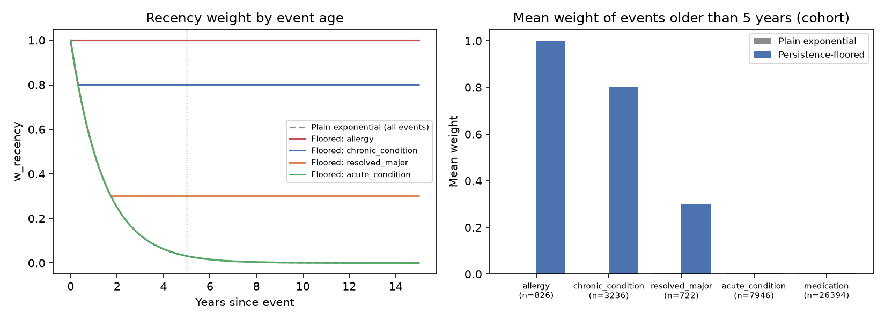

## 5. Set selection: independent top-K vs greedy cross-domain set

Same scores; top-K takes the 5 highest independently, the greedy set applies synergy (α = 0.3), the time budget (with look-ahead) and at most 2 items per domain.

| arm | lists | mean_conflicts | lists_with_conflict | mean_domains | within_budget | mean_minutes | mean_score_sum |
|---|---|---|---|---|---|---|---|
| greedy_set | 775 | 0.46 | 36.0% | 3.37 | 100.0% | 44.9 | 3.230 |
| independent_top_k | 775 | 5.06 | 84.1% | 2.03 | 47.2% | 56.2 | 3.529 |

The greedy set has fewer conflicts per list, covers more domains and stays within budget in 100.0% of lists, at the cost of a lower summed score (3.230 vs 3.529). Conflicts counted include same-tag redundancy pairs (e.g. two recipes).

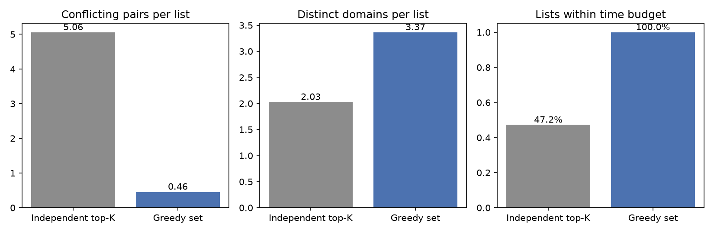

## 6. Weight learning: fixed vs learned weights (simulated users)

775 simulated users × 30 rounds × 5 items, two arms with common random numbers. Both arms adapt each user's history, intensity caps and preferred tags from feedback; the learned arm also refits w1..w7 every 5 rounds by logistic regression on its own log. Simulator calibration: base offset -1.75 so that about half of round-1 items are accepted.

| index | fixed | learned |
|---|---|---|
| rounds 1-5 | 56.0% | 56.0% |
| last 5 rounds | 61.9% | 63.8% |

Weights after each refit:

| round | R | G | U | P | F | H | C |
|---|---|---|---|---|---|---|---|
| 0.000 | 0.250 | 0.200 | 0.200 | 0.100 | 0.100 | 0.100 | 0.050 |
| 5.000 | 0.055 | 0.099 | 0.042 | 0.094 | 0.268 | 0.328 | 0.114 |
| 10.000 | 0.059 | 0.103 | 0.040 | 0.089 | 0.236 | 0.390 | 0.082 |
| 15.000 | 0.052 | 0.096 | 0.043 | 0.079 | 0.201 | 0.460 | 0.070 |
| 20.000 | 0.048 | 0.097 | 0.045 | 0.073 | 0.169 | 0.512 | 0.057 |
| 25.000 | 0.043 | 0.089 | 0.042 | 0.065 | 0.171 | 0.540 | 0.050 |
| 30.000 | 0.043 | 0.088 | 0.039 | 0.062 | 0.157 | 0.566 | 0.045 |

What the learned weights favour: mean term values of the final lists for the 775 patients (no feedback history, so H is constant):

| arm | R | G | U | P | F | H | C |
|---|---|---|---|---|---|---|---|
| default | 0.882 | 0.649 | 0.699 | 0.174 | 0.993 | 0.500 | 0.218 |
| learned | 0.812 | 0.638 | 0.578 | 0.194 | 0.998 | 0.500 | 0.216 |

**Caveats.** (1) This demonstrates the adaptation mechanism on simulated users, not real-world effectiveness; the learned weights reflect the simulator's assumptions. (2) H (historical adherence) is computed from the same feedback the learner trains on, so its weight is inflated by a feedback loop (users who accept more have higher H). (3) Maximising acceptance pushes down health relevance and urgency, so the learned weights are **not** used as the live setting; the hand-set defaults remain live and the learned weights are opt-in (`04_run_pipeline.py --weights learned`).

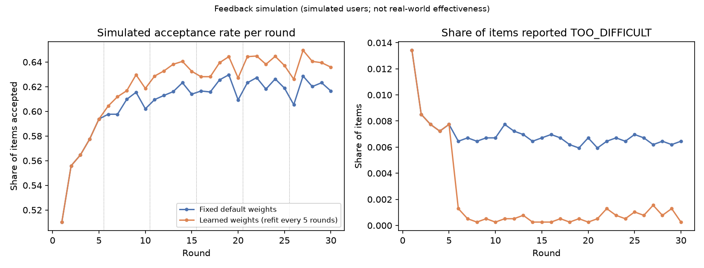

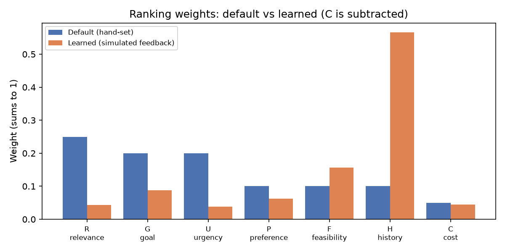

## 7. Risk model: logistic regression vs XGBoost

Kaggle CVD data after cleaning: 68,610 rows (dropped 1,334 for impossible blood pressure, 56 for implausible height/weight). Split 70/15/15 stratified: {'train': 48027, 'val': 10291, 'test': 10292}. XGBoost tuned on validation (16 configurations; best {'max_depth': 4, 'learning_rate': 0.05, 'n_estimators': 200}); chosen model xgboost with isotonic calibration.

Test set:

| index | roc_auc | pr_auc | accuracy | f1 | brier |
|---|---|---|---|---|---|
| logistic_regression | 0.7945 | 0.7724 | 0.7314 | 0.7136 | 0.1854 |
| xgboost | 0.8063 | 0.7887 | 0.7421 | 0.7289 | 0.1780 |
| xgboost_calibrated | 0.8059 | 0.7817 | 0.7414 | 0.7294 | 0.1781 |

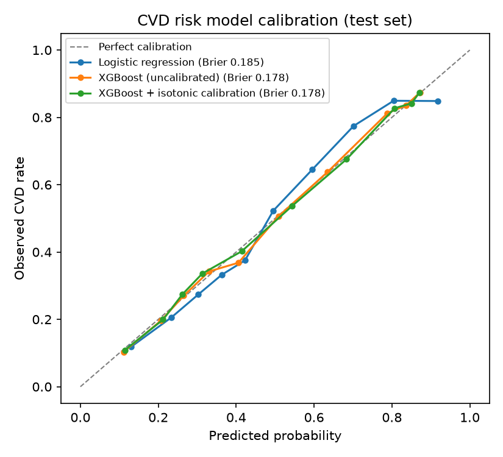

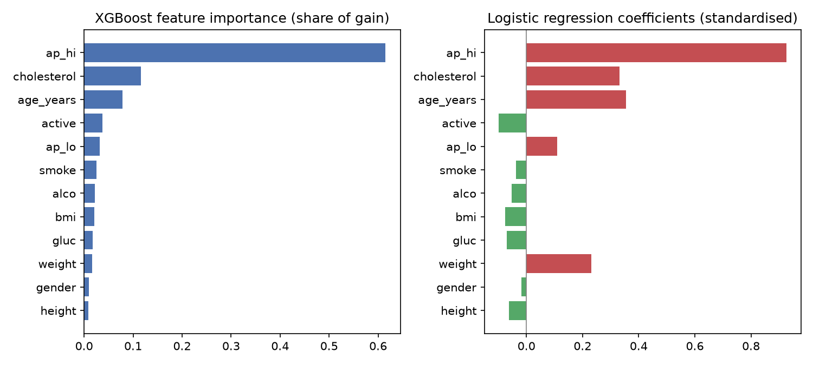

Applied to the Synthea cohort, features come from the latest readings. Missing labs default to level 1 (cholesterol imputed for 194, glucose for 342 of 775 patients) and 319 patients are outside the training age range (29-65), where the model treats age as the nearest training age.

## Case studies

### Case 1: rising blood pressure (hypertensive trend)

Patient `355d5f82`: M, 64 years. Goals: lower blood pressure, better sleep. Daily budget 30 min. Survey injury: back. Diet: omnivore. CVD risk (model): 85%.

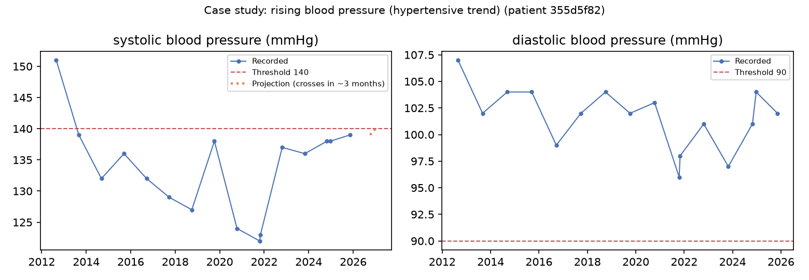

**Profile (metrics with a threshold):**

| metric | current | threshold | trend | slope / year | urgency | status |
|---|---|---|---|---|---|---|
| BMI | 28.1 kg/m2 | 30 | stable | -0.00 | 0.00 | moving away |
| diastolic blood pressure | 102 mmHg | 90 | stable | +1.33 | 1.00 | past threshold |
| HDL cholesterol | 53 mg/dL | 40 | insufficient | +0.96 | 0.00 | insufficient data |
| LDL cholesterol | 95 mg/dL | 160 | insufficient | +4.46 | 0.00 | insufficient data |
| sleep duration | 6.0 h | 6 | falling | -0.62 | 1.00 | past threshold |
| daily steps | 5,893 steps/day | 5,000 | stable | -43.65 | 0.00 | approaching |
| systolic blood pressure | 139 mmHg | 140 | rising | +3.97 | 0.59 | approaching |
| total cholesterol | 168 mg/dL | 240 | insufficient | +4.49 | 0.00 | insufficient data |

**Active conditions (5):** Chronic sinusitis (disorder); Essential hypertension (disorder); Chronic neck pain (finding); Chronic low back pain (finding); Chronic pain (finding)

**Active medications:** 12 HR Hydrocodone Bitartrate 10 MG Extended Release Oral Capsule; Acetaminophen 325 MG / Oxycodone Hydrochloride 10 MG Oral Tablet [Percocet]; lisinopril 10 MG Oral Tablet

**Allergies:** none → mapped allergens: none

**Safety filter:** 5,077 candidates → 3,350 kept (1,727 removed).

| rule_id | reason | candidates removed | example |
|---|---|---|---|
| back_heavy_load | Puts heavy load on the spine | 1 | Do a 45-minute heavy weight-training session |
| hypertension_sodium_cap | Too much sodium for someone with high blood pressure | 1723 | Cook: virginia fried soft shell crabs |
| joint_high_impact | High-impact exercise is not suitable with a knee or back injury or osteoarthritis | 3 | Do 25 minutes of jog-walk intervals |

**Final recommendations (default weights):**

1. **Try 15 minutes of progressive muscle relaxation** [wellness, 15 min, score 0.793]  
   - Your sleep recently averages 5.96 hours a night, below the 6-hour threshold.
   - Supports your goals: lower blood pressure, better sleep.
   - _terms: R=1.00 G=1.00 U=1.00 P=0.00 F=1.00 H=0.50 C=0.15_
2. **Have one screen-free evening each week** [wellness, 5 min, score 0.685]  
   - Your sleep recently averages 5.96 hours a night, below the 6-hour threshold.
   - Supports your goal: better sleep.
   - _terms: R=1.00 G=0.50 U=1.00 P=0.00 F=1.00 H=0.50 C=0.30_
3. **Put screens away 60 minutes before bed** [sleep, 5 min, score 0.680]  
   - Your sleep recently averages 5.96 hours a night, below the 6-hour threshold.
   - Supports your goal: better sleep.
   - _terms: R=1.00 G=0.50 U=1.00 P=0.00 F=1.00 H=0.50 C=0.40_
4. **Avoid alcohol within 3 hours of bedtime** [sleep, 1 min, score 0.685]  
   - Your sleep recently averages 5.96 hours a night, below the 6-hour threshold.
   - Supports your goal: better sleep.
   - _terms: R=1.00 G=0.50 U=1.00 P=0.00 F=1.00 H=0.50 C=0.30_
5. **Keep alcohol to at most one drink a day** [lifestyle, 1 min, score 0.560]  
   - Your estimated cardiovascular risk is 85%, and this supports heart health.
   - Your systolic blood pressure has risen about 4.0 mmHg per year and is projected to reach 140 in about 3 months.
   - _terms: R=0.85 G=0.50 U=0.59 P=0.00 F=1.00 H=0.50 C=0.40_

_Wellness guidance only. Not medical advice._

### Case 2: prediabetes (no diabetes) with a rising glycaemic trend

Patient `f58a6077`: F, 47 years. Goals: glucose control. Daily budget 25 min. Survey injury: back. Diet: low_carb. CVD risk (model): 31%.

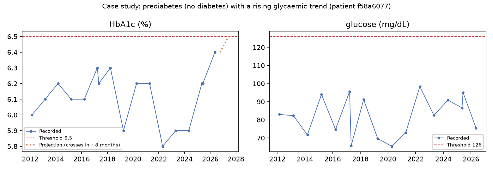

**Profile (metrics with a threshold):**

| metric | current | threshold | trend | slope / year | urgency | status |
|---|---|---|---|---|---|---|
| BMI | 30.1 kg/m2 | 30 | stable | +0.27 | 1.00 | past threshold |
| diastolic blood pressure | 84 mmHg | 90 | stable | -0.48 | 0.00 | moving away |
| glucose | 76 mg/dL | 126 | falling | -3.08 | 0.00 | moving away |
| HbA1c | 6.4 % | 6.5 | rising | +0.15 | 0.54 | approaching |
| HDL cholesterol | 55 mg/dL | 40 | insufficient | +1.18 | 0.00 | insufficient data |
| LDL cholesterol | 109 mg/dL | 160 | insufficient | +1.28 | 0.00 | insufficient data |
| sleep duration | 7.0 h | 6 | falling | -0.63 | 0.20 | approaching |
| daily steps | 4,307 steps/day | 5,000 | falling | -956.55 | 1.00 | past threshold |
| systolic blood pressure | 120 mmHg | 140 | stable | -1.60 | 0.00 | moving away |
| total cholesterol | 188 mg/dL | 240 | insufficient | +1.48 | 0.00 | insufficient data |

**Active conditions (10):** Recurrent urinary tract infection (disorder); Chronic sinusitis (disorder); Pulmonary emphysema (disorder); Prediabetes (finding); Chronic neck pain (finding); Chronic low back pain (finding); Chronic pain (finding); Body mass index 30+ - obesity (finding); Loss of teeth (disorder); Past pregnancy history of miscarriage (situation)

**Active medications:** 60 ACTUAT Fluticasone propionate 0.25 MG/ACTUAT / salmeterol 0.05 MG/ACTUAT Dry Powder Inhaler; 72 HR Fentanyl 0.025 MG/HR Transdermal System; Abuse-Deterrent 12 HR Oxycodone Hydrochloride 10 MG Extended Release Oral Tablet [Oxycontin]; Acetaminophen 325 MG / Oxycodone Hydrochloride 10 MG Oral Tablet [Percocet]; albuterol 5 MG/ML Inhalation Solution; {5 (dienogest 2 MG / estradiol valerate 2 MG Oral Tablet) / 17 (dienogest 3 MG / estradiol valerate 2 MG Oral Tablet) / 2 (estradiol valerate 1 MG Oral Tablet) / 2 (estradiol valerate 3 MG Oral Tablet) / 2 (inert ingredients 1 MG Oral Tablet) } Pack [Natazia 28 Day]

**Allergies:** none → mapped allergens: none

**Safety filter:** 5,077 candidates → 3,301 kept (1,776 removed).

| rule_id | reason | candidates removed | example |
|---|---|---|---|
| back_heavy_load | Puts heavy load on the spine | 1 | Do a 45-minute heavy weight-training session |
| diabetes_sugar_cap | Too much sugar for someone with diabetes or prediabetes | 1772 | Cook: thai citrus chicken salad |
| joint_high_impact | High-impact exercise is not suitable with a knee or back injury or osteoarthritis | 3 | Do 25 minutes of jog-walk intervals |

**Final recommendations (default weights):**

1. **Cook: cajun chicken salad** [nutrition, 5 min, score 0.898]  
   - Your latest BMI is 30.1 kg/m2, above the 30 threshold.
   - Supports your goal: glucose control.
   - _terms: R=1.00 G=1.00 U=1.00 P=1.00 F=1.00 H=0.50 C=0.05_
2. **Take a 10-minute walk after dinner** [fitness, 10 min, score 0.793]  
   - Your daily steps recently average 4,307, below the 5,000 threshold.
   - Supports your goal: glucose control.
   - _terms: R=1.00 G=1.00 U=1.00 P=0.00 F=1.00 H=0.50 C=0.15_
3. **Cook: blender chicken quesadillas** [nutrition, 6 min, score 0.897]  
   - Your latest BMI is 30.1 kg/m2, above the 30 threshold.
   - Supports your goal: glucose control.
   - _terms: R=1.00 G=1.00 U=1.00 P=1.00 F=1.00 H=0.50 C=0.06_
4. **Set a daily reminder to take prescribed medicines as directed** [preventive_care, 1 min, score 0.652]  
   - Your record lists prediabetes; this supports glucose control.
   - Supports your goal: glucose control.
   - _terms: R=0.80 G=1.00 U=0.54 P=0.00 F=1.00 H=0.50 C=0.10_
5. **Ask your clinician whether an HbA1c test is due** [preventive_care, 2 min, score 0.647]  
   - Your record lists prediabetes; this supports glucose control.
   - Supports your goal: glucose control.
   - _terms: R=0.80 G=1.00 U=0.54 P=0.00 F=1.00 H=0.50 C=0.20_

_Wellness guidance only. Not medical advice._

### Case 3: food allergy and an injury

Patient `dd9da64b`: F, 40 years. Goals: glucose control, more activity. Daily budget 55 min. Survey injury: back. Diet: low_carb. CVD risk (model): 13%.

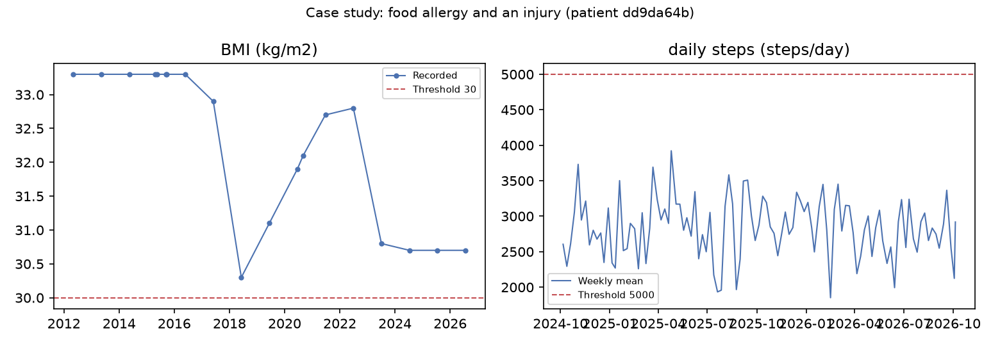

**Profile (metrics with a threshold):**

| metric | current | threshold | trend | slope / year | urgency | status |
|---|---|---|---|---|---|---|
| BMI | 30.7 kg/m2 | 30 | stable | -0.42 | 1.00 | past threshold |
| diastolic blood pressure | 81 mmHg | 90 | stable | -1.08 | 0.00 | moving away |
| glucose | 93 mg/dL | 126 | stable | -0.10 | 0.00 | moving away |
| HbA1c | 5.9 % | 6.5 | stable | -0.04 | 0.00 | moving away |
| HDL cholesterol | 48 mg/dL | 40 | insufficient | -0.75 | 0.00 | insufficient data |
| LDL cholesterol | 112 mg/dL | 160 | insufficient | +6.53 | 0.00 | insufficient data |
| sleep duration | 7.8 h | 6 | stable | -0.10 | 0.00 | approaching |
| daily steps | 2,919 steps/day | 5,000 | stable | -41.46 | 1.00 | past threshold |
| systolic blood pressure | 115 mmHg | 140 | stable | -0.00 | 0.00 | moving away |
| total cholesterol | 181 mg/dL | 240 | insufficient | +3.91 | 0.00 | insufficient data |

**Active conditions (9):** Atopic dermatitis (disorder); Asthma (disorder); Body mass index 30+ - obesity (finding); Chronic neck pain (finding); Chronic low back pain (finding); Chronic pain (finding); History of tubal ligation (situation); Anemia (disorder); Prediabetes (finding)

**Active medications:** Acetaminophen 300 MG / Hydrocodone Bitartrate 5 MG Oral Tablet; Chlorpheniramine Maleate 2 MG/ML Oral Solution; NDA020800 0.3 ML Epinephrine 1 MG/ML Auto-Injector; NDA021457 200 ACTUAT albuterol 0.09 MG/ACTUAT Metered Dose Inhaler [ProAir]; budesonide 0.25 MG/ML Inhalation Suspension

**Allergies:** Grass pollen (substance); House dust mite (organism); Animal dander (substance); Cow's milk (substance); Allergic disposition (finding); Shellfish (substance); Fish (substance); Peanut (substance); Mold (organism) → mapped allergens: fish, milk, peanut, shellfish

**Safety filter:** 5,077 candidates → 1,035 kept (4,042 removed).

| rule_id | reason | candidates removed | example |
|---|---|---|---|
| allergy_match | Contains an ingredient you are allergic to | 3420 | Eat oily fish such as salmon or sardines twice a week |
| back_heavy_load | Puts heavy load on the spine | 1 | Do a 45-minute heavy weight-training session |
| diabetes_sugar_cap | Too much sugar for someone with diabetes or prediabetes | 1772 | Cook: thai citrus chicken salad |
| joint_high_impact | High-impact exercise is not suitable with a knee or back injury or osteoarthritis | 3 | Do 25 minutes of jog-walk intervals |

**Final recommendations (default weights):**

1. **Take a 10-minute walk after dinner** [fitness, 10 min, score 0.843]  
   - Your daily steps recently average 2,919, below the 5,000 threshold.
   - Supports your goals: glucose control, more activity.
   - _terms: R=1.00 G=1.00 U=1.00 P=0.50 F=1.00 H=0.50 C=0.15_
2. **Cook: cajun chicken salad** [nutrition, 5 min, score 0.798]  
   - Your latest BMI is 30.7 kg/m2, above the 30 threshold.
   - Supports your goal: glucose control.
   - _terms: R=1.00 G=0.50 U=1.00 P=1.00 F=1.00 H=0.50 C=0.05_
3. **Do 15 minutes of resistance-band strength exercises** [fitness, 15 min, score 0.785]  
   - Your latest BMI is 30.7 kg/m2, above the 30 threshold.
   - Supports your goals: glucose control, more activity.
   - _terms: R=1.00 G=1.00 U=1.00 P=0.00 F=1.00 H=0.50 C=0.30_
4. **Cook: easiest chicken ever** [nutrition, 6 min, score 0.797]  
   - Your latest BMI is 30.7 kg/m2, above the 30 threshold.
   - Supports your goal: glucose control.
   - _terms: R=1.00 G=0.50 U=1.00 P=1.00 F=1.00 H=0.50 C=0.06_
5. **Raise your daily step goal by 1,000 steps** [lifestyle, 10 min, score 0.738]  
   - Your daily steps recently average 2,919, below the 5,000 threshold.
   - Supports your goal: more activity.
   - _terms: R=1.00 G=0.50 U=1.00 P=0.50 F=1.00 H=0.50 C=0.25_

_Wellness guidance only. Not medical advice._

## Limitations

- Clinical data is synthetic (Synthea); lifestyle, goals, preferences, injuries and feedback are simulated.
- Thresholds and safety rules are simplified illustrations and have not been reviewed by a clinician.
- Recipe allergens are found by ingredient keyword matching, which can miss unlisted names. An audit against Food.com's own fish/seafood tags during this evaluation found 38 untagged seafood recipes (e.g. basa, hake, orange roughy); the keyword lists were extended and all results regenerated, but the method remains imperfect and real use would need a curated ingredient-allergen database.
- The linear trend projection assumes the recent trend continues; Synthea readings are roughly yearly.
- Recipe diet tags only look at sodium, sugar, protein and meat content, not overall food quality. In an earlier run a hot-dog recipe ranked first for a prediabetic patient; processed meats and alcohol are now excluded from the recipe pool, but other low-quality foods could still score well.
- Learned weights reflect the simulator's assumptions and a feedback loop in the history term.
- The risk model is trained on a different population (Kaggle, ages 29-65) than it is applied to.
- The system gives wellness guidance only and does not diagnose or prescribe.
